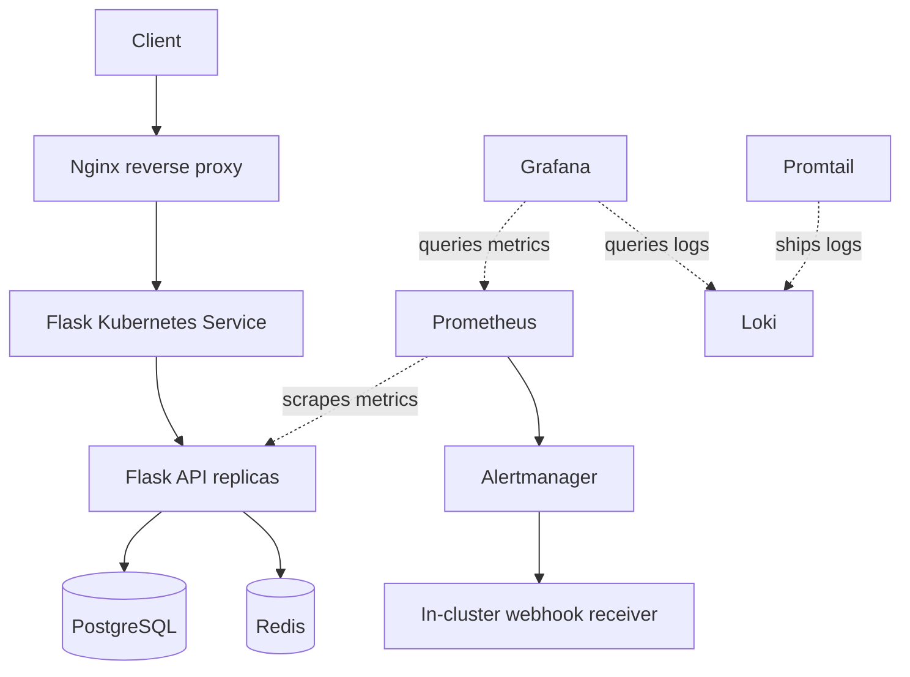
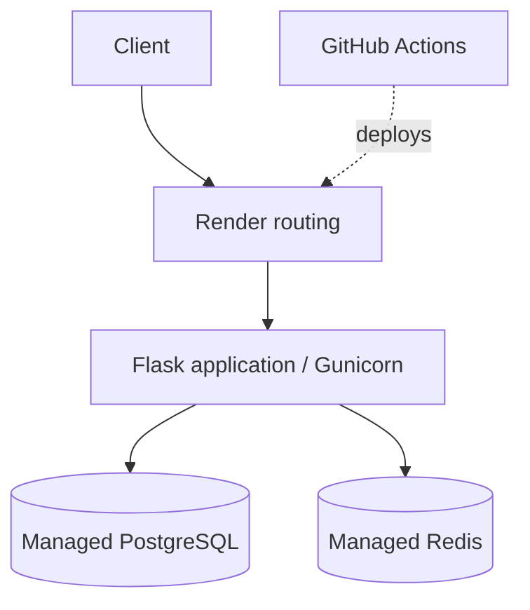

# Ziad DevOps 180 🚀

[](https://github.com/2nothing4/ziad-devops-180/actions/workflows/render-deploy.yml)

A hands-on DevOps learning platform that brings together a Flask API, containerization, Kubernetes, Helm, CI/CD, infrastructure as code, observability, and security checks.

**Start here:** [Debugging incidents](docs/day29-loki-promtail-debug.md) — documented failures, root-cause analysis, and fixes are a central part of this project.

> **Scope note:** The Kubernetes environment is a local Minikube lab. The public web deployment runs on Render. The AWS Terraform work is architecture/IaC planning unless and until an AWS deployment is explicitly documented and verified. These are separate environments, not one identical production deployment.

## 📑 Table of Contents

- [What runs where?](#what-runs-where)
- [Live demo](#live-demo)
- [Architecture](#architecture)
- [Technology and capabilities](#technology-and-capabilities)
- [Engineering examples](#engineering-examples)
- [Tests and validation](#tests-and-validation)
- [Security and operational considerations](#security-and-operational-considerations)
- [Project status](#project-status)
- [Reproduce and inspect](#reproduce-and-inspect)
- [Known limitations](#known-limitations)

---

## What runs where?

| Capability | Local lab (Minikube) | Hosted deployment (Render) |
|---|---|---|
| Flask API | Kubernetes deployment; 3 replicas described in configuration | Flask served with Gunicorn |
| Nginx | Reverse-proxy entry point in the local stack | Render-managed ingress/platform routing |
| PostgreSQL | Local Kubernetes service and persistent-storage configuration | Managed PostgreSQL |
| Redis | Local Kubernetes service | Managed Redis |
| Helm | Packages the Kubernetes resources | Not used to deploy the Render service |
| Terraform / AWS | AWS architecture and Terraform validation/planning | Not represented as a live AWS deployment |

## Live demo

**Hosted API:** [https://ziad-flask-app.onrender.com](https://ziad-flask-app.onrender.com)

*Note: The Render free tier may take around 50 seconds to wake from inactivity.*

| Endpoint | Purpose (as documented by this project) | Status |
|---|---|---|
| `/` | Service status | Reported live |
| `/health` | PostgreSQL health check | Reported live |
| `/logs` | Query results exposed by the application | Reported live |
| `/cache` | Redis cache test | Reported live |
| `/metrics` | Prometheus-format application metrics | Reported live |

*Note: The `/logs` route returns database query results rather than infrastructure logs. Renaming it to `/records` is planned to avoid confusion; update the route, tests, and documentation together if you make this change.*

---

## Architecture

### Local Kubernetes lab



### Hosted Render deployment



*Verify both diagrams against the current configuration and deployment workflow before publishing. They should represent actual connections, not intended architecture.*

## Technology and capabilities

- **Application:** Python, Flask, PostgreSQL, Redis, Gunicorn
- **Containers:** Docker, Docker Compose
- **Orchestration and packaging:** Kubernetes (Minikube), Helm
- **Infrastructure as code:** Terraform; AWS architecture planning and validation
- **CI/CD and GitOps:** GitHub Actions, Argo CD (local GitOps configuration)
- **Metrics and alerting:** Prometheus, Grafana, Alertmanager, custom application metrics and alert rules
- **Logging:** Loki and Promtail
- **Security and networking:** Kubernetes Secrets, RBAC, NetworkPolicies, Trivy, Checkov
- **Ingress and TLS:** Nginx; cert-manager with self-signed TLS

---

## Engineering examples

### 1. Nginx returned HTTP 502

- **Symptom:** Requests through Nginx returned `502 Bad Gateway`.
- **Root cause:** The Nginx upstream referenced a Kubernetes Service name that did not exist.
- **Fix:** Corrected the upstream Service name and redeployed the configuration.
- **Lesson:** Kubernetes service discovery depends on correct Service names and DNS resolution.

### 2. Alertmanager could not reach the webhook receiver

- **Symptom:** Alertmanager could not reach a receiver running on the WSL2 host.
- **Root cause:** `host.minikube.internal` resolved to an unsuitable network interface in this setup.
- **Fix:** Deployed the receiver inside the cluster and exposed it through a Kubernetes Service.
- **Lesson:** Cluster workloads should normally use Kubernetes Service discovery for in-cluster communication instead of relying on host networking.

### 3. Loki / Promtail troubleshooting

See the [Loki and Promtail troubleshooting guide](docs/day29-loki-promtail-debug.md) for detailed log-aggregation debugging.

---

## Tests and validation

The project includes a `pytest` suite covering `/health`, `/cache`, and `/metrics`, with database connections mocked in the test environment.

**Important interpretation:** Mocked database connections validate application behavior under those tests; they do not prove end-to-end database integration. Unit/mock tests and real-dependency integration tests should be distinguished clearly.

- `pytest` is reported as integrated into GitHub Actions.
- CI runs Docker image build validation.
- CI runs Helm linting and manifest-rendering validation.

*Before publishing these claims, confirm that the current workflow actually executes each check and fails when a check fails.*

---

## Security and operational considerations

### Implemented (verify against the current source)

- Trivy and Checkov scanning integrated into CI.
- Credential management using Kubernetes Secrets.
- RBAC and NetworkPolicies configured for the local Minikube environment.

### Planned for future validation

- End-to-end tests with real PostgreSQL and Redis dependencies.
- Documented backup and restore exercises, including a successful restore test.
- Controlled alert-trigger testing, covering both firing and resolution.
- Non-root containers and read-only filesystem configurations, if not already implemented.
- Least-privilege `GITHUB_TOKEN` permissions and pinned third-party Actions.

---

## Project status

| Area | Evidence described in the project | Boundary to communicate |
|---|---|---|
| Docker / Compose | Local application stack | Demonstrate a clean build |
| Kubernetes / Helm | Minikube deployment, health checks, and resource settings | A local cluster does not prove production high availability |
| Terraform | Modules and AWS architecture planning | A successful plan is not a deployed AWS environment |
| CI/CD | GitHub Actions workflows | Verify exactly which tests and validations run |
| Observability | Prometheus, Alertmanager, Loki, and Promtail | Alerting evidence applies to the tested local setup |
| Security | Trivy and Checkov checks | Scanning does not by itself prove the absence of vulnerabilities |

---

## Reproduce and inspect

Prerequisites for the local Kubernetes lab include Docker, `kubectl`, Minikube, Helm, Python, and the project's test dependencies.

### 1. Run the tests

From the repository root:

```bash
python -m pip install -r requirements.txt
python -m pytest
```

### 2. Validate the Helm chart

```bash
helm lint ./helm/ziad-devops
helm template ziad-devops ./helm/ziad-devops
```

### 3. Deploy the local stack

Review the chart values and required configuration before deployment.

```bash
helm install ziad-devops ./helm/ziad-devops
kubectl get pods
kubectl get services
```

Use the project's documented configuration and teardown instructions when reproducing the complete environment. Confirm that the commands above work against the current chart before publishing them as verified instructions.

**Never commit real passwords, tokens, private keys, or populated `.env` files.**

---

## Known limitations

- The local Kubernetes environment is Minikube, not a managed production cluster.
- The Render deployment uses Render's hosting model and is architecturally distinct from the local Kubernetes lab.
- The AWS Terraform work is described as planning/validation, not a live AWS deployment.
- Tests that mock database connections are not proof of end-to-end database integration.
- A self-signed certificate demonstrates TLS configuration but is not equivalent to a publicly trusted production certificate.
