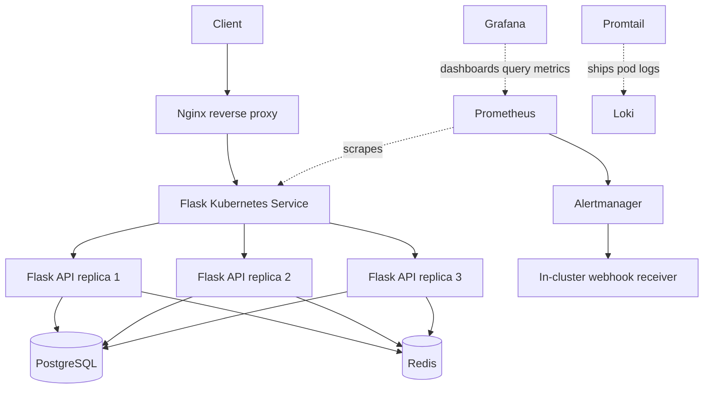
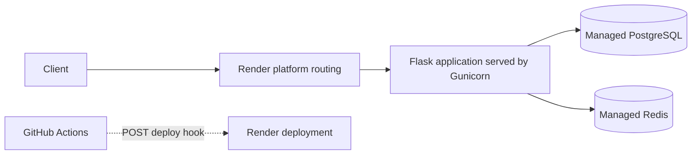

<div align="center">

<h1 align="center"><strong>🚀 Ziad DevOps 180</strong></h1>

### Build. Deploy. Observe. Troubleshoot.

A hands-on DevOps engineering project exploring the workflow around a Flask service: containers, Kubernetes, Helm, CI/CD, infrastructure as code, observability, and security tooling.

<p>
  <a href="https://github.com/2nothing4/ziad-devops-180/actions/workflows/render-deploy.yml"></a>
  
  
  
  
  
  
</p>

**An independent DevOps learning and engineering project by [Ziad](https://github.com/2nothing4).**

</div>

---

## ✨ Overview

`ziad-devops-180` is a practical engineering project built around a small Flask API and the infrastructure required to run, expose, monitor, and troubleshoot it.

The repository contains a local Kubernetes lab, a separately hosted Render deployment, infrastructure-as-code experiments, CI workflows, and observability/security configurations. The project also records debugging incidents so that implementation decisions and failure modes are visible—not just the final configuration.

> [!IMPORTANT]
> **Environment boundaries matter.** The Kubernetes environment is a local Minikube lab. The public web application is hosted separately on Render. The AWS Terraform configuration is infrastructure design and validation work; this repository does **not** demonstrate a deployed AWS production environment. These are separate environments, not one end-to-end production platform.

**Start with:** [Incident reports](docs/incidents/) · [Loki / Promtail troubleshooting](docs/day29-loki-promtail-debug.md) · [GitHub repository](https://github.com/2nothing4/ziad-devops-180)

## 📑 Contents

- [What runs where?](#what-runs-where)
- [Hosted application and API](#hosted-application-and-api)
- [Architecture](#architecture)
- [Technology and capabilities](#technology-and-capabilities)
- [Engineering examples](#engineering-examples)
- [Validation and CI](#validation-and-ci)
- [Kubernetes, Helm and GitOps](#kubernetes-helm-and-gitops)
- [Terraform and AWS scope](#terraform-and-aws-scope)
- [Security and operational notes](#security-and-operational-notes)
- [Reproduce and inspect](#reproduce-and-inspect)
- [Known limitations](#known-limitations)

---

<a id="what-runs-where"></a>

## 🧭 What runs where?

| Component / capability | Local lab · Minikube | Hosted service · Render | AWS environment |
|:--|:--|:--|:--|
| Flask API | Kubernetes Deployment; the `ziad-devops` template specifies 3 replicas | Flask application served through Gunicorn | Not deployed |
| Nginx | Reverse proxy in the local Kubernetes configuration | Render handles platform routing | An ALB/security-group design is present in Terraform; no live ALB deployment is demonstrated |
| PostgreSQL | Local Kubernetes workload and persistent-volume configuration | External managed PostgreSQL configured through environment variables | RDS architecture is defined in Terraform; not deployed |
| Redis | Local Kubernetes workload | External managed Redis configured through environment variables | ElastiCache architecture is defined in Terraform; not deployed |
| Observability | Prometheus, Grafana, Alertmanager, Loki and Promtail manifests/configuration | Not represented as the same observability stack | Not deployed |
| GitOps | Argo CD Application manifest targets the local cluster | Not used for the Render deployment | Not deployed |
| Infrastructure as code | Terraform Docker module/environment and AWS architecture files | Not used to provision Render | AWS architecture/planning only |

> [!NOTE]
> The table describes what is represented in the repository. A manifest or Terraform resource definition is not, by itself, proof that the resource is currently running.

<a id="hosted-application-and-api"></a>

## 🌐 Hosted application and API

**Public application URL:** [https://ziad-flask-app.onrender.com](https://ziad-flask-app.onrender.com)

The Flask application defines the following routes:

| Endpoint | Implemented behavior | Important detail |
|:--|:--|:--|
| `/` | Returns service metadata and status | Reports whether the app detects a `DATABASE_URL` environment variable |
| `/health` | Checks PostgreSQL connectivity with `SELECT 1` | This is a database-backed health check, not a full dependency or end-to-end health assessment |
| `/logs` | Returns the latest database rows from the `logs` table | These are application database records, **not infrastructure/container logs** |
| `/cache` | Writes and reads a Redis key | A simple cache connectivity exercise; it performs a write on each request |
| `/metrics` | Exposes Prometheus client metrics | Includes request counters and a request-latency histogram registered by the application |

> [!TIP]
> The `/logs` route name can be confused with centralized infrastructure logging. Renaming it to `/records` is a possible cleanup, but update the route, tests, dashboards or consumers, and documentation together if you make that change.

*The route descriptions above are based on the application source. Public availability and response behavior can change with the hosting service and its configured dependencies; this README is not an uptime guarantee.*

---

<a id="architecture"></a>

## 🏗️ Architecture

### 1. Local Kubernetes lab

The local application path is Nginx → Kubernetes Service → Flask API → PostgreSQL / Redis. Observability components collect metrics and logs through separate paths.



The three API replicas are specified in `ziad-devops/templates/api.yaml`. Actual replica count depends on which chart is deployed and the cluster state.

### 2. Hosted Render application



The Render workflow installs the application dependencies, performs a Python import check, and sends a POST request to the configured Render deploy hook. It does not perform a post-deployment smoke test of the public endpoints.

### 3. AWS architecture · planned, not deployed

The Terraform AWS architecture describes a proposed design involving a VPC, public/private subnets, EKS, RDS PostgreSQL, ElastiCache Redis, IAM roles and security groups. It is kept separate from the Render service and local Minikube cluster.

> [!WARNING]
> The AWS configuration is **not ready to be represented as a deployed production environment**. It needs further network, subnet, egress, database, credential and security review before any real AWS apply. Do not apply it to a real account based on the diagram alone.

---

<a id="technology-and-capabilities"></a>

## 🧰 Technology and capabilities

| Area | Technologies / configuration represented in the repository |
|:--|:--|
| Application | Python, Flask, Gunicorn, PostgreSQL, Redis |
| Containers | Docker, Docker Compose |
| Orchestration | Kubernetes, Minikube |
| Packaging | Helm |
| Infrastructure as code | Terraform, Docker provider module, AWS provider configuration |
| CI/CD | GitHub Actions, Render deploy hook |
| GitOps | Argo CD Application manifest for the local cluster |
| Metrics and alerting | Prometheus, Grafana, Alertmanager, custom Flask metrics and alert rules |
| Logging | Loki, Promtail |
| Security and networking | Trivy, Checkov, Kubernetes Secrets, RBAC, NetworkPolicies |
| Ingress and TLS | Nginx, cert-manager, self-signed issuer/certificate configuration |

<a id="engineering-examples"></a>

## 🧯 Engineering examples

The repository includes documented troubleshooting work. These examples show the observed symptom, the identified cause, and the corrective change.

### 1. Nginx returned `502 Bad Gateway`

- **Symptom:** Requests routed through Nginx returned HTTP 502.
- **Root cause:** The Nginx upstream referenced a Kubernetes Service name that did not exist in the deployed configuration.
- **Fix:** Corrected the upstream Service name and redeployed the configuration.
- **Takeaway:** Kubernetes service discovery depends on accurate Service names and DNS resolution.
- **Report:** [`001-nginx-502.md`](docs/incidents/001-nginx-502.md)

### 2. Alertmanager could not reach its webhook receiver

- **Symptom:** Alertmanager could not reach a receiver running on the WSL2 host.
- **Root cause:** `host.minikube.internal` resolved to an unsuitable network interface in this setup.
- **Fix:** Moved the receiver into the Kubernetes cluster and exposed it through a Kubernetes Service.
- **Takeaway:** In-cluster workloads should generally use Kubernetes Service discovery for in-cluster communication rather than relying on host networking.
- **Report:** [`002-alertmanager-networking.md`](docs/incidents/002-alertmanager-networking.md)

### 3. Loki / Promtail permissions and log collection

The repository includes a troubleshooting guide for the Loki/Promtail logging setup and an incident report covering permissions.

- [Loki / Promtail troubleshooting guide](docs/day29-loki-promtail-debug.md)
- [003-loki-promtail-permissions.md](docs/incidents/003-loki-promtail-permissions.md)

---

<a id="validation-and-ci"></a>

## ✅ Validation and CI

The repository currently contains separate workflows. Their scope should be described precisely:

| Workflow | What the checked-in workflow does | What it does **not** establish |
|:--|:--|:--|
| `pytest.yml` | Installs `day9-flask/requirements.txt`, installs pytest, and runs `pytest -v` on Python 3.12 | Does not provide end-to-end tests with real PostgreSQL and Redis services |
| `docker-build.yml` | Builds the Flask Docker image; runs `helm lint` and `helm template` against `./ziad-devops` | Does not publish the image to a registry or prove that the Argo CD chart deploys successfully |
| `render-deploy.yml` | Installs dependencies, imports the Flask app, then sends a POST request to the Render deploy hook on pushes to `main` | Does not verify the deployed service with post-deploy HTTP smoke tests |
| `security.yml` | Runs Trivy filesystem scanning and Checkov scanning, then uploads SARIF reports | Checkov is configured with `soft_fail: true`; scanning is not currently a strict security release gate |

### Current pytest coverage

The checked-in test file currently contains **two tests**:

- `test_health_endpoint` — checks that `/health` returns HTTP 200 with database dependencies mocked.
- `test_metrics_endpoint` — checks that `/metrics` returns HTTP 200.

The `/cache` endpoint is **not** currently covered by an automated test; the test file contains a comment noting that it is exercised locally. The tests mock database and Redis modules, so they do not prove real database/cache integration.

### Run the existing tests

From the repository root:

```bash
python -m pip install -r day9-flask/requirements.txt
python -m pip install pytest
python -m pytest -v
```

### Build the application image

From the repository root:

```bash
docker build -t flask-app:latest ./day9-flask
```

### Validate the chart used by the Docker/Helm workflow

The checked-in `docker-build.yml` workflow runs these commands against `ziad-devops`:

```bash
helm lint ./ziad-devops
helm template my-app ./ziad-devops
```

> [!IMPORTANT]
> **There are currently two Helm chart directories.** The Argo CD Application manifest at `argocd/application.yaml` points to `helm/ziad-devops`, while the Docker/Helm CI workflow validates `ziad-devops`. These are different chart directories. The CI checks therefore do not validate the chart path currently referenced by Argo CD. Consolidate the charts or explicitly document and test their separate purposes before treating the deployment workflow as reproducible.

---

<a id="kubernetes-helm-and-gitops"></a>

## ☸️ Kubernetes, Helm and GitOps

The repository contains Kubernetes manifests and Helm templates for the API, Nginx, PostgreSQL, Redis, monitoring components, RBAC, NetworkPolicies, persistent storage and cert-manager resources.

The Argo CD Application manifest references:

```text
Repository:     https://github.com/2nothing4/ziad-devops-180
Target revision: HEAD
Chart path:     helm/ziad-devops
Namespace:      default
```

The separate `ziad-devops/` directory is the chart currently linted and rendered by `docker-build.yml`.

Before documenting a one-command deployment, align these pieces:

1. Choose the canonical Helm chart or document why two charts are maintained.
2. Make the API image name and tag consistent between the Docker build and the chart used for deployment.
3. Verify that the image is available to Minikube (for example, through a deliberate local image-build/load workflow or a registry).
4. Run an actual install/sync and verify pods, services, probes, storage and network policies.

Until those items are reconciled and exercised, this README documents the manifests and validation steps without claiming a clean-clone, one-command Kubernetes deployment.

---

<a id="terraform-and-aws-scope"></a>

## ☁️ Terraform and AWS scope

Terraform work is separated into distinct areas:

| Path | Purpose |
|:--|:--|
| `terraform/modules/docker-web/` | Reusable module using the Docker provider |
| `terraform/environments/dev/` | Development environment that calls the Docker module |
| `terraform/aws-architecture/` | Proposed AWS architecture for VPC, EKS, RDS, ElastiCache, IAM and security groups |

The AWS configuration is an architecture/IaC exercise. It has not been applied to AWS, and a successful `terraform validate` or `terraform plan` would not mean those resources are deployed or operational.

Before any real AWS deployment, the design still requires review—including the RDS subnet group currently referencing only one subnet, private-subnet egress/routing, EKS node networking, database credentials, security-group rules and production-grade secret handling.

---

<a id="reproduce-and-inspect"></a>

## 🔁 Reproduce and inspect

The repository contains runnable application code, automated checks, local infrastructure definitions and AWS planning artifacts. Use the commands below to reproduce the checks that are currently represented in CI. They do not imply that every infrastructure environment is deployed or fully integrated.

### Prerequisites

- Git and Python. The pytest workflow currently uses Python 3.12; the application Dockerfile currently uses `python:3.14-slim`. Keep these versions aligned as the project is hardened.
- Docker, if you want to build the Flask image.
- Helm, if you want to lint and render the chart.
- Terraform, if you want to inspect the Terraform configurations.
- Minikube and `kubectl` for the local Kubernetes lab.

### Run the existing tests

From the repository root:

```bash
python -m pip install -r day9-flask/requirements.txt
python -m pip install pytest
python -m pytest -v
```

### Build the Flask image

```bash
docker build -t flask-app:latest ./day9-flask
```

### Lint and render the chart currently checked by CI

```bash
helm lint ./ziad-devops
helm template my-app ./ziad-devops
```

The Argo CD Application points to a different chart directory (`helm/ziad-devops`). Do not treat the commands above as validation of the Argo CD chart until the two chart paths are reconciled.

### Inspect the AWS Terraform configuration

The following commands perform formatting, initialization and static validation; they do not deploy AWS resources:

```bash
terraform -chdir=terraform/aws-architecture fmt -check
terraform -chdir=terraform/aws-architecture init -backend=false
terraform -chdir=terraform/aws-architecture validate
```

Review the AWS design and credentials carefully. Do not run `terraform apply` against a real account until the outstanding network, subnet, security and secret-management issues have been resolved and independently reviewed.

---

<a id="security-and-operational-notes"></a>

## 🔐 Security and operational notes

The repository contains security-related configurations, but they should be interpreted within the scope of this learning environment.

### Present in the repository

- Trivy filesystem scanning and Checkov infrastructure/configuration scanning in GitHub Actions.
- Kubernetes Secret, RBAC and NetworkPolicy manifests.
- cert-manager issuer and certificate manifests using a self-signed certificate.
- Prometheus alert rules and an in-cluster webhook receiver configuration.

### Items that still need hardening or verification

- **Demo credentials:** the source snapshot contains plaintext demonstration/default passwords in application, Helm and Terraform configuration. They are not suitable for real environments. Replace them with externally supplied values or proper secret references; rotate them if they have ever been reused outside the lab.
- **Application error responses:** some database exception text is returned to API clients. Return generic client-facing errors and keep diagnostic detail in server-side logs.
- **Database initialization:** `init_db()` is called when the Flask module is imported. Move schema management to an explicit migration/startup process rather than relying on import-time side effects.
- **Security workflow enforcement:** Checkov is configured to soft-fail, and the Trivy/Checkov actions use floating `@master` references in the checked-in workflow. Review action pinning and define deliberate failure thresholds.
- **Container hardening:** verify non-root execution, filesystem permissions and image/dependency hygiene before claiming hardened production containers.
- **Grafana / Loki integration:** Promtail and Loki configuration is present, but the checked-in Grafana configuration does not provision a Loki data source. Add and verify that integration before claiming Grafana-based log exploration.
- **Recovery:** add documented backup/restore exercises and prove that a restore succeeds.

> [!CAUTION]
> Do not put real credentials, private keys, populated `.env` files, Terraform state, or saved plans containing sensitive values into the repository. A scan is useful evidence, not proof that a system is secure.

---

<a id="known-limitations"></a>

## 📍 Known limitations and project boundaries

- Kubernetes work is based on a local Minikube environment, not a managed production cluster.
- The Render application is a separate hosted deployment, not a Kubernetes deployment.
- AWS infrastructure is defined as Terraform planning/design work and has not been deployed.
- The current pytest suite contains two mocked endpoint tests; it is not an end-to-end integration suite.
- The repository contains two different Helm chart directories, and the Argo CD path differs from the chart validated by CI.
- The Docker workflow builds `flask-app:latest`, while the checked-in Helm templates use different API image names. The image build and Helm deployment are not yet demonstrated as one connected release pipeline.
- The self-signed TLS configuration demonstrates certificate automation concepts; it is not equivalent to a publicly trusted production certificate.
- The current AWS Terraform design needs further networking, subnet, security and credential review before any real deployment.

---

## 📚 References

- [Docker documentation](https://docs.docker.com/)
- [Kubernetes documentation](https://kubernetes.io/docs/)
- [Minikube documentation](https://minikube.sigs.k8s.io/docs/)
- [Helm documentation](https://helm.sh/docs/)
- [Terraform documentation](https://developer.hashicorp.com/terraform/docs)
- [Argo CD documentation](https://argo-cd.readthedocs.io/)
- [Prometheus documentation](https://prometheus.io/docs/)
- [Grafana documentation](https://grafana.com/docs/)
- [Trivy documentation](https://trivy.dev/latest/)
- [Checkov documentation](https://www.checkov.io/)

---

<div align="center">

### Built through hands-on practice by [Ziad](https://github.com/2nothing4)

[Repository](https://github.com/2nothing4/ziad-devops-180) · [GitHub profile](https://github.com/2nothing4) · [Incident reports](docs/incidents/)

*Learn by building. Improve by debugging. Prove it with evidence.*

</div>
