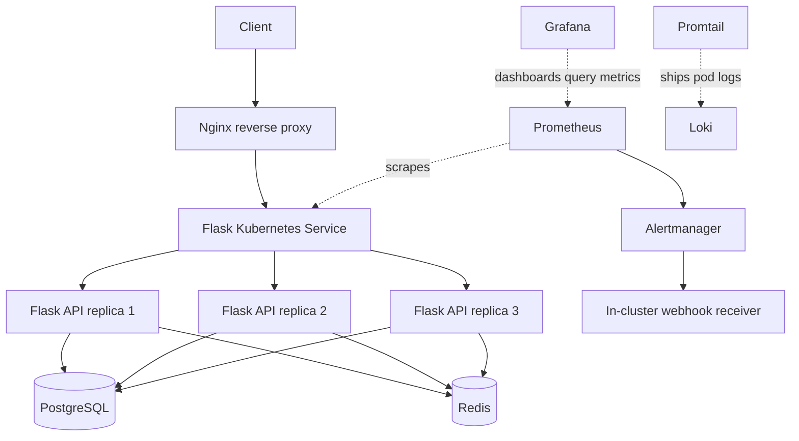
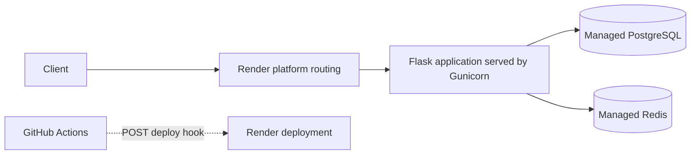

<div align="center">

<h1 align="center"><strong>🚀 Ziad DevOps 180</strong></h1>

### Build. Deploy. Observe. Troubleshoot.

A hands-on DevOps engineering project exploring the workflow around a Flask service: containers, Kubernetes, Helm, CI/CD, infrastructure as code, observability, and security tooling.

<p>
  <a href="https://github.com/2nothing4/ziad-devops-180/actions/workflows/render-deploy.yml"></a>
  
  
  
  
  
  
</p>

**An independent DevOps learning and engineering project by [Ziad](https://github.com/2nothing4).**

</div>

---

## ✨ Overview

`ziad-devops-180` is a practical engineering project built around a Flask API and the infrastructure required to run, expose, monitor, and troubleshoot it.

The repository contains a local Kubernetes lab, a separately hosted Render deployment, infrastructure-as-code experiments, CI workflows, and observability/security configurations. It also records debugging incidents so that implementation decisions and failure modes are visible—not just the final configuration.

> [!IMPORTANT]
> **Environment boundaries matter.** The Kubernetes environment is a local Minikube lab. The public web application is hosted separately on Render. The AWS Terraform configuration is infrastructure design and validation work; this repository does **not** demonstrate a deployed AWS production environment. These are separate environments, not one end-to-end production platform.

**Start with:** [Incident reports](docs/incidents/) · [Loki / Promtail troubleshooting](docs/day29-loki-promtail-debug.md) · [GitHub repository](https://github.com/2nothing4/ziad-devops-180)

## 📑 Contents

- [What runs where?](#what-runs-where)
- [Hosted application and API](#hosted-application-and-api)
- [Architecture](#architecture)
- [Technology and capabilities](#technology-and-capabilities)
- [Engineering examples](#engineering-examples)
- [Validation and CI](#validation-and-ci)
- [Kubernetes, Helm and GitOps](#kubernetes-helm-and-gitops)
- [Terraform and AWS scope](#terraform-and-aws-scope)
- [Security and operational notes](#security-and-operational-notes)
- [Reproduce and inspect](#reproduce-and-inspect)
- [Known limitations](#known-limitations)

---

<a id="what-runs-where"></a>

## 🧭 What runs where?

| Component / capability | Local lab · Minikube | Hosted service · Render | AWS environment |
|:--|:--|:--|:--|
| Flask API | Kubernetes Deployment; the canonical `helm/ziad-devops` chart specifies 3 replicas | Flask application served through Gunicorn | Not deployed |
| Nginx | Reverse proxy in the local Kubernetes configuration | Render handles platform routing | An ALB/security-group design is present in Terraform; no live ALB deployment is demonstrated |
| PostgreSQL | Local Kubernetes workload and persistent-volume configuration | Managed PostgreSQL configured through environment variables | RDS architecture is defined in Terraform; not deployed |
| Redis | Local Kubernetes workload | Managed Redis configured through environment variables | ElastiCache architecture is defined in Terraform; not deployed |
| Observability | Prometheus, Grafana, Alertmanager, Loki and Promtail manifests/configuration | Not represented as the same observability stack | Not deployed |
| GitOps | Argo CD Application manifest targets the local cluster | Not used for the Render deployment | Not deployed |
| Infrastructure as code | Terraform Docker module/environment and AWS architecture files | Not used to provision Render | AWS architecture/planning only |

> [!NOTE]
> The table describes what is represented in the repository. A manifest or Terraform resource definition is not, by itself, proof that the resource is currently running.

<a id="hosted-application-and-api"></a>

## 🌐 Hosted application and API

**Public application URL:** [https://ziad-flask-app.onrender.com](https://ziad-flask-app.onrender.com)

Deployment is automated through GitHub Actions and a Render deploy hook. The deployment workflow runs its configured steps and sends a request to trigger a Render deployment. A successful deploy-hook request means that the deployment was triggered or queued; it does **not**, by itself, prove that the new application version has finished deploying or is healthy.

The Flask application defines the following routes:

| Endpoint | Implemented behavior | Important detail |
|:--|:--|:--|
| `/` | Returns service metadata and status | Reports whether the app detects a `DATABASE_URL` environment variable |
| `/health` | Checks PostgreSQL connectivity with `SELECT 1` | This is a database-backed health check, not a full dependency or end-to-end health assessment |
| `/logs` | Returns the latest database rows from the `logs` table | These are application database records, **not infrastructure/container logs** |
| `/cache` | Writes and reads a Redis key | A simple cache connectivity exercise; it performs a write on each request |
| `/metrics` | Exposes Prometheus-format application metrics | Includes request counters and a request-latency histogram registered by the application |

> [!TIP]
> The `/logs` route name can be confused with centralized infrastructure logging. Renaming it to `/records` is a possible cleanup, but update the route, tests, dashboards or consumers, and documentation together if you make that change.

*The route descriptions above are based on the application implementation described in this project. Public availability and response behavior can change with the hosting service and its configured dependencies; this README is not an uptime guarantee.*

---

<a id="architecture"></a>

## 🏗️ Architecture

### 1. Local Kubernetes lab

The local application path is Nginx → Kubernetes Service → Flask API → PostgreSQL / Redis. Observability components collect metrics and logs through separate paths.



The three API replicas are specified in the canonical `helm/ziad-devops/templates/api.yaml` chart template. Actual replica count depends on the chart values and cluster state.

### 2. Hosted Render application



The Render workflow installs the application dependencies, performs a Python import check, and sends a POST request to the configured Render deploy hook. It does not currently establish deployment health through a post-deployment HTTP smoke test.

### 3. AWS architecture · planned, not deployed

The Terraform AWS architecture describes a proposed design involving a VPC, public/private subnets, EKS, RDS PostgreSQL, ElastiCache Redis, IAM roles and security groups. It is kept separate from the Render service and local Minikube cluster.

> [!WARNING]
> The AWS configuration is **not ready to be represented as a deployed production environment**. It needs further network, subnet, egress, database, credential and security review before any real AWS apply. Do not apply it to a real account based on the diagram alone.

---

<a id="technology-and-capabilities"></a>

## 🧰 Technology and capabilities

| Area | Technologies / configuration represented in the repository |
|:--|:--|
| Application | Python, Flask, Gunicorn, PostgreSQL, Redis |
| Containers | Docker, Docker Compose |
| Orchestration | Kubernetes, Minikube |
| Packaging | Helm |
| Infrastructure as code | Terraform, Docker provider module, AWS provider configuration |
| CI/CD | GitHub Actions, Render deploy hook |
| GitOps | Argo CD Application manifest for the local cluster |
| Metrics and alerting | Prometheus, Grafana, Alertmanager, custom Flask metrics and alert rules |
| Logging | Loki, Promtail |
| Security and networking | Trivy, Checkov, Kubernetes Secrets, RBAC, NetworkPolicies |
| Ingress and TLS | Nginx, cert-manager, self-signed issuer/certificate configuration |

<a id="engineering-examples"></a>

## 🧯 Engineering examples

The repository includes documented troubleshooting work. These examples show the observed symptom, the identified cause, and the corrective change.

### 1. Nginx returned `502 Bad Gateway`

- **Symptom:** Requests routed through Nginx returned HTTP 502.
- **Root cause:** The Nginx upstream referenced a Kubernetes Service name that did not exist in the deployed configuration.
- **Fix:** Corrected the upstream Service name and redeployed the configuration.
- **Takeaway:** Kubernetes service discovery depends on accurate Service names and DNS resolution.
- **Report:** [`001-nginx-502.md`](docs/incidents/001-nginx-502.md)

### 2. Alertmanager could not reach its webhook receiver

- **Symptom:** Alertmanager could not reach a receiver running on the WSL2 host.
- **Root cause:** `host.minikube.internal` resolved to an unsuitable network interface in this setup.
- **Fix:** Moved the receiver into the cluster and exposed it through a Kubernetes Service.
- **Takeaway:** In-cluster workloads should generally use Kubernetes Service discovery for in-cluster communication rather than relying on host networking.
- **Report:** [`002-alertmanager-networking.md`](docs/incidents/002-alertmanager-networking.md)

### 3. Loki / Promtail permissions and log collection

The repository includes a troubleshooting guide for the Loki/Promtail logging setup and an incident report covering permissions.

- [Loki / Promtail troubleshooting guide](docs/day29-loki-promtail-debug.md)
- [`003-loki-promtail-permissions.md`](docs/incidents/003-loki-promtail-permissions.md)

### 4. Helm configuration drift

- **Symptom:** CI validated one Helm chart directory while the Argo CD Application referenced another.
- **Root cause:** Two separate chart directories had evolved independently, allowing validation and GitOps deployment to target different manifests.
- **Fix:** Consolidated the chart into `helm/ziad-devops` and updated the CI workflow, Argo CD Application and rebuild script to use the canonical path.
- **Takeaway:** CI validation and GitOps deployment should reference the same source of truth.

### 5. Dependency-path mismatch after repository restructuring

- **Symptom:** Moving the main `requirements.txt` to the repository root broke build steps that still expected the file under `day9-flask/`.
- **Root cause:** The Docker build and Render configuration used different file/path assumptions after the repository layout changed.
- **Fix:** Updated the Docker build to use the repository root as its build context, adjusted the Dockerfile copy paths, and added a nested requirements include for the application-directory path expected by the Render configuration.
- **Takeaway:** A dependency file's location, a Docker build context, and a hosting platform's configured root directory are separate concerns that must be aligned.

---

<a id="validation-and-ci"></a>

## ✅ Validation and CI

The repository uses separate GitHub Actions workflows for tests, container/Helm validation, Render deployment triggering, and security scanning. The following describes the intended/current workflow behavior based on the recent project changes; check the workflow files and latest Actions run for the definitive state of each job.

| Workflow | What it does | What it does **not** establish |
|:--|:--|:--|
| `pytest.yml` | Installs the root `requirements.txt`, installs pytest, and runs `pytest -v` on Python 3.12 | Does not provide end-to-end tests against live PostgreSQL and Redis services |
| `docker-build.yml` | Builds the Flask image using the repository root as build context; runs `helm lint` and `helm template` against `./helm/ziad-devops` | Does not publish the image to a registry or by itself prove that Argo CD deployed the same image successfully |
| `render-deploy.yml` | Installs dependencies, performs a Python import check, and sends a POST request to the configured Render deploy hook on pushes to `main` | Does not perform a post-deployment HTTP smoke test or independently prove the new version is healthy |
| `security.yml` | Runs Trivy filesystem scanning and Checkov scanning, then uploads SARIF reports | Checkov is configured with `soft_fail: true` in the reviewed workflow; scanning is not a strict security release gate while that setting remains enabled |

### Current pytest coverage

The test suite contains **five tests** covering the `/health`, `/metrics`, and `/cache` endpoints:

- `test_health_endpoint` — checks that `/health` returns HTTP 200 with database dependencies mocked.
- `test_metrics_endpoint` — checks that `/metrics` returns HTTP 200.
- `test_cache_endpoint_success` — verifies the `/cache` success path using a mocked Redis client, including the expected cache write/read behavior.
- `test_cache_endpoint_redis_failure` — simulates a Redis connection failure and checks that the endpoint returns a controlled error response.

External database and Redis interactions are mocked where applicable, allowing isolated test execution in CI. These tests validate application behavior under the tested scenarios; they do **not** replace integration tests against real PostgreSQL and Redis services.

### Run the tests

From the repository root:

```bash
python -m pip install -r requirements.txt
python -m pip install pytest
python -m pytest -v
```

### Build the application image

The Docker build uses the repository root as its build context so the Dockerfile can access the root dependency file and the application source under `day9-flask/`:

```bash
docker build -f day9-flask/Dockerfile -t flask-app:latest .
```

### Validate the canonical Helm chart

CI and the Argo CD Application now target the same chart directory: `helm/ziad-devops`.

```bash
helm lint ./helm/ziad-devops
helm template ziad-devops ./helm/ziad-devops
```

The chart consolidation removes the previous directory mismatch. A successful lint/template run validates chart syntax and rendered manifests; it does not, by itself, prove that a live Minikube deployment is healthy.

### Render dependency-file compatibility

The root `requirements.txt` is the canonical dependency list. The nested `day9-flask/requirements.txt` file is retained as a compatibility include for tooling/configuration that expects a requirements file in the application directory:

```text
-r ../requirements.txt
```

This include assumes the Render service/build environment can access the repository root. Keep the Render Root Directory and build command aligned with that layout; if the service root is restricted to `day9-flask`, the parent requirements file may not be available.

---

<a id="kubernetes-helm-and-gitops"></a>

## ☸️ Kubernetes, Helm and GitOps

The repository contains Kubernetes manifests and Helm templates for the API, Nginx, PostgreSQL, Redis, monitoring components, RBAC, NetworkPolicies, persistent storage and cert-manager resources.

The canonical Argo CD Application and CI chart path is:

```text
Repository:      https://github.com/2nothing4/ziad-devops-180
Target revision: HEAD
Chart path:      helm/ziad-devops
Namespace:       default
```

The chart directory was consolidated during the Day 37 configuration-drift fix. The CI workflow, Argo CD Application and `rebuild.sh` are intended to use the same canonical chart path.

The next deployment-quality checks are to verify that:

1. The API image name and tag in the Docker build match the image configured in the canonical Helm chart.
2. The image is available to Minikube (for example, through a deliberate local image-build/load workflow or a registry).
3. An actual Argo CD sync/install succeeds.
4. Pods, Services, probes, storage and NetworkPolicies behave as intended in the cluster.

A single chart path removes configuration drift between chart directories, but image consistency and a successful cluster deployment still require their own verification.

---

<a id="terraform-and-aws-scope"></a>

## ☁️ Terraform and AWS scope

Terraform work is separated into distinct areas:

| Path | Purpose |
|:--|:--|
| `terraform/modules/docker-web/` | Reusable module using the Docker provider |
| `terraform/environments/dev/` | Development environment that calls the Docker module |
| `terraform/aws-architecture/` | Proposed AWS architecture for VPC, EKS, RDS, ElastiCache, IAM and security groups |

The AWS configuration is an architecture/IaC exercise. It has not been applied to AWS, and a successful `terraform validate` or `terraform plan` would not mean those resources are deployed or operational.

Before any real AWS deployment, the design still requires review—including the RDS subnet group currently referencing only one subnet, private-subnet egress/routing, EKS node networking, database credentials, security-group rules and production-grade secret handling.

---

<a id="security-and-operational-notes"></a>

## 🔐 Security and operational notes

The repository contains security-related configurations, but they should be interpreted within the scope of this learning environment.

### Implemented

- **API error handling:** Replaced raw exception details in client-facing JSON responses for `/health`, `/logs`, and `/cache` with generic error messages. Exception details are written to server-side process output for troubleshooting; this is basic output logging, not yet a structured logging system.
- **Failure-path testing:** Added a mocked Redis failure test to verify that the `/cache` endpoint returns a controlled error response when the dependency fails.
- **Security scanning:** Trivy filesystem scanning and Checkov infrastructure/configuration scanning are integrated into GitHub Actions.
- **Kubernetes credentials:** Kubernetes Secret manifests are used for application configuration in the local lab.
- **Access control:** RBAC and NetworkPolicies are configured for the local Minikube environment.
- **TLS configuration:** cert-manager issuer and certificate manifests use a self-signed certificate configuration.

### Items that still need hardening or verification

- **Demo credentials:** The previously reviewed source snapshot contained plaintext demonstration/default passwords in application, Helm and Terraform configuration. Confirm these have been removed or replaced with externally supplied values before any real deployment. Rotate them if they have ever been reused outside the lab.
- **Structured logging:** Replace basic `print()`-based exception output with a configured logger, appropriate severity levels, and useful contextual fields.
- **Database initialization:** The previously reviewed source snapshot called `init_db()` during module import. The application lifecycle should be refactored so importing the Flask app does not implicitly initialize the database. Record this as completed only after the updated implementation and tests verify it.
- **Security workflow enforcement:** Checkov was configured with `soft_fail: true` in the reviewed workflow, and the Trivy/Checkov actions used floating `@master` references. Review the current workflow, pin third-party actions to reviewed versions/SHAs, and define deliberate failure thresholds.
- **Container hardening:** Verify non-root execution, filesystem permissions and image/dependency hygiene before claiming hardened production containers.
- **Grafana / Loki integration:** Promtail and Loki configuration is present, but the previously reviewed Grafana configuration did not provision a Loki data source. Add and verify that integration before claiming Grafana-based log exploration.
- **Recovery:** Add documented backup/restore exercises and prove that a restore succeeds.
- **Post-deployment verification:** Add a separate post-deploy smoke test or health-check step; a successful Render deploy-hook request alone is not sufficient evidence of application health.

> [!CAUTION]
> Do not put real credentials, private keys, populated `.env` files, Terraform state, or saved plans containing sensitive values into the repository. A scan is useful evidence, not proof that a system is secure.

---

<a id="reproduce-and-inspect"></a>

## 🔁 Reproduce and inspect

The repository contains runnable application code, automated checks, local infrastructure definitions and AWS planning artifacts. The commands below reproduce the checks currently documented in the project. They do not imply that every infrastructure environment is deployed or fully integrated.

### Prerequisites

- Git and Python. The pytest workflow currently uses Python 3.12; the application Dockerfile uses `python:3.14-slim`. Keep these versions aligned as the project is hardened.
- Docker, if you want to build the Flask image.
- Helm, if you want to lint and render the chart.
- Terraform, if you want to inspect the Terraform configurations.
- Minikube and `kubectl` for the local Kubernetes lab.

### 1. Install dependencies and run tests

From the repository root:

```bash
python -m pip install --upgrade pip
python -m pip install -r requirements.txt
python -m pip install pytest
python -m pytest -v
```

### 2. Build the Flask image

From the repository root:

```bash
docker build -f day9-flask/Dockerfile -t flask-app:latest .
```

### 3. Lint and render the canonical Helm chart

```bash
helm lint ./helm/ziad-devops
helm template ziad-devops ./helm/ziad-devops
```

### 4. Inspect the AWS Terraform configuration

The following commands perform formatting, initialization and static validation; they do not deploy AWS resources:

```bash
terraform -chdir=terraform/aws-architecture fmt -check
terraform -chdir=terraform/aws-architecture init -backend=false
terraform -chdir=terraform/aws-architecture validate
```

Review the AWS design and credentials carefully. Do not run `terraform apply` against a real account until the outstanding network, subnet, security and secret-management issues have been resolved and independently reviewed.

---

<a id="known-limitations"></a>

## 📍 Known limitations and project boundaries

- Kubernetes work is based on a local Minikube environment, not a managed production cluster.
- The Render application is a separate hosted deployment, not a Kubernetes deployment.
- AWS infrastructure is defined as Terraform planning/design work and has not been deployed.
- The current pytest suite contains four endpoint tests using mocked dependencies where applicable; it is not an end-to-end integration suite.
- The CI workflows validate the canonical Helm chart path, but a successful lint/template run does not prove an actual Argo CD sync or healthy cluster deployment.
- The Docker workflow builds an image, but end-to-end image publishing and consumption by the Kubernetes deployment still need explicit verification.
- The Render workflow triggers deployment but does not currently prove post-deployment application health through an HTTP smoke test.
- Checkov is configured with `soft_fail: true` in the reviewed workflow; security findings may not fail the job while that setting remains enabled.
- The self-signed TLS configuration demonstrates certificate automation concepts; it is not equivalent to a publicly trusted production certificate.
- The current AWS Terraform design needs further networking, subnet, security and credential review before any real deployment.

---

## 📚 References

- [Docker documentation](https://docs.docker.com/)
- [Kubernetes documentation](https://kubernetes.io/docs/)
- [Minikube documentation](https://minikube.sigs.k8s.io/docs/)
- [Helm documentation](https://helm.sh/docs/)
- [Terraform documentation](https://developer.hashicorp.com/terraform/docs)
- [Argo CD documentation](https://argo-cd.readthedocs.io/)
- [Prometheus documentation](https://prometheus.io/docs/)
- [Grafana documentation](https://grafana.com/docs/)
- [Trivy documentation](https://trivy.dev/latest/)
- [Checkov documentation](https://www.checkov.io/)

---

<div align="center">

### Built through hands-on practice by [Ziad](https://github.com/2nothing4)

[Repository](https://github.com/2nothing4/ziad-devops-180) · [GitHub profile](https://github.com/2nothing4) · [Incident reports](docs/incidents/)

*Learn by building. Improve by debugging. Prove it with evidence.*

</div>